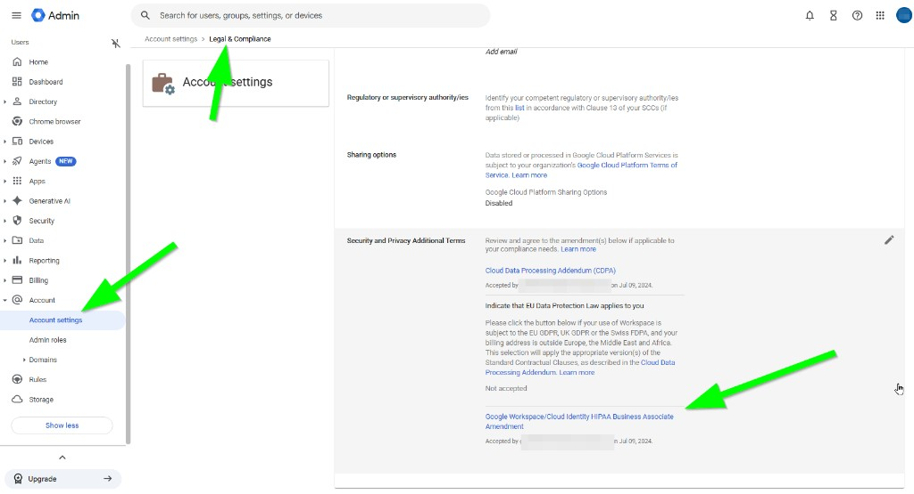

# HIPAA, BAA & Legal Compliance in Google Workspace

Healthcare nonprofits, clinics, and other **compliance-conscious** organizations often need proof that Google’s contractual terms are in place before they store sensitive data in Google Workspace. Most of that paperwork lives in one Admin console page: **Account settings → Legal & compliance**.


You must be a **super administrator**. Legacy free editions and non-admin accounts cannot accept these terms. Signing a BAA does **not** by itself make your org HIPAA-compliant—you still must follow [Google’s HIPAA guidance](https://knowledge.workspace.google.com/admin/compliance/hipaa-compliance-with-google-workspace-and-cloud-identity) and only use [HIPAA Included Functionality](https://workspace.google.com/terms/2017/10/premier/terms/included_functionality.html) with protected health information (PHI).


## Open Legal & compliance

1. Sign in to the [Google Admin console](https://admin.google.com) as a **super admin**.
2. Go to **Menu** → **Account** → **Account settings** → **Legal & compliance** ([direct link](https://admin.google.com/ac/companyprofile/legal)).
3. On that page, find **Security and Privacy Additional Terms** (HIPAA BAA, CDPA, and EU data protection options).


You will also see **Google Cloud Platform sharing options** on this page. Many nonprofits enable it during [initial Workspace setup](configure-google-workspace-for-nonprofit.md#account-settings).


---

## HIPAA: Business Associate Amendment (BAA)

Under **HIPAA**, health information classified as **PHI** may only go into Google Workspace if your organization has a **Business Associate Agreement** with Google—and you use covered services the way Google documents.

**Before you accept:** Confirm you are a HIPAA **covered entity** (or business associate that needs a BAA). Do **not** store PHI in Workspace until the BAA is accepted **and** you follow Google’s configuration guidance.

<figure><figcaption>
<strong>Account</strong> → <strong>Account settings</strong> → <strong>Legal &amp; compliance</strong> — the HIPAA BAA is at the bottom of <strong>Security and Privacy Additional Terms</strong>.
</figcaption></figure>

**How to review and accept the BAA**

1. On **Legal & compliance**, in **Security and Privacy Additional Terms**, open **Google Workspace/Cloud Identity HIPAA Business Associate Amendment**.
2. Click **Review and Accept**.
3. Answer Google’s **three questions** to confirm you are a HIPAA covered entity.
4. Click **OK** to accept.

**How to “download” or keep a copy:** Google does **not** provide a separate PDF download of an individually signed BAA in Admin console. Acceptance is **electronic** and binding. For audits, Google advises keeping a **screenshot** of the **Legal & compliance** page showing the BAA as **Accepted** (with date and accepting admin), or your org’s change-management record. See Google’s FAQ: [HIPAA compliance with Google Workspace](https://support.google.com/a/answer/3407054).

**After acceptance**

* Read [HIPAA compliance with Google Workspace and Cloud Identity](https://knowledge.workspace.google.com/admin/compliance/hipaa-compliance-with-google-workspace-and-cloud-identity).
* Configure only [HIPAA Included Functionality](https://workspace.google.com/terms/2017/10/premier/terms/included_functionality.html)—third-party add-ons are **not** covered by the BAA.
* Use [Google’s HIPAA Implementation Guide](https://services.google.com/fh/files/misc/google_workspace_and_cloud_identity_hipaa_implementation_guide.pdf) for sharing, retention, and access controls.


**Nonprofit licensing:** Most free **Google Workspace for Nonprofits** tenants can accept the BAA, but using PHI still requires eligible services and strict admin settings. If you are unsure whether your edition or use case qualifies, involve legal counsel before putting PHI in Gmail, Drive, or Calendar.


---

## Cloud Data Processing Addendum (CDPA)

The **Cloud Data Processing Addendum (CDPA)** is Google’s contract language for how Google processes your organization’s data as a **data processor** under privacy laws (including GDPR-style requirements). It spells out security, subprocessors, and related obligations.

**Who should accept it:** Any organization that wants a clear, administrator-accepted record of data-processing terms—especially if auditors, insurers, or funders ask about cloud privacy compliance.

**How to accept**

1. On **Legal & compliance**, under **Cloud Data Processing Addendum to Google Workspace or Cloud Identity Agreement** (top of **Security and Privacy Additional Terms**), click **Review and Accept**.
2. Have legal counsel or your privacy lead read the terms if your org requires it.
3. Click **I Accept**.

Google’s steps and background: [Privacy compliance and records](https://knowledge.workspace.google.com/admin/compliance/privacy-compliance-and-records-for-google-workspace-and-cloud-identity) · [Cloud Data Processing Addendum (PDF/terms)](https://cloud.google.com/terms/data-processing-addendum)

### Compliance contacts on the same page

On **Legal & compliance**, finish the privacy-related fields your organization needs:

| Task | When to use it |
| --- | --- |
| **Indicate that EU Data Protection Law applies to you** | Your Workspace use is subject to EU GDPR, UK GDPR, or Swiss FDPA (even if billing is outside EMEA). |
| **Your Supervisory Authority/ies** | Required when EU/UK/Swiss law applies—list the regulator(s) that oversee your org. |
| **Register DPO or representative for the GDPR** | When you must name a Data Protection Officer or EU representative under GDPR. |

Even US-only nonprofits often fill in a **DPO or compliance contact** here when donors or partners expect documented privacy governance. Use roles and names your org actually maintains.

---

## Related setup


[configure-google-workspace-for-nonprofit.md](configure-google-workspace-for-nonprofit.md)


**Google’s compliance hub:** [Google Workspace legal and compliance](https://knowledge.workspace.google.com/admin/compliance/google-workspace-legal-and-compliance)
