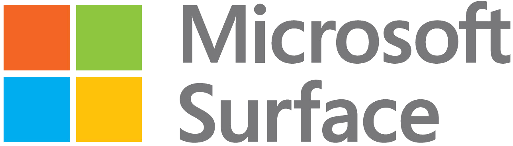

# Computers & Servers

For nonprofits, procuring computers and other tech equipment can be challenging on a budget. Below, we outline some great resources for finding low-cost or free computers.


**If you only pick one:** Buy a Windows 11 Pro laptop with 16 GB RAM and a 512 GB SSD. TechSoup, Dell Refurbished, and the [CTL Reuse Store](https://reuse.ctl.net/) (3R Technology) are the usual starting points.



We only recommend purchasing Windows 11 computers. [Windows 10 became obsolete in October 2025](https://www.microsoft.com/en-us/windows/end-of-support?r=1).


## Computer minimum requirements (recommended)

We recommend only buying PCs that meet these minimum specs:

* **Windows version:** **Windows 11**, not Windows 10. [Windows 10 became obsolete in October 2025](https://www.microsoft.com/en-us/windows/end-of-support?r=1).
* **Windows edition:** **Windows 11 Pro** (not Home)
  * Home cannot join Microsoft Entra ID (Azure AD) or an Active Directory domain.
  * Home often ships with extra consumer apps (“bloatware”).
  * If you must buy Windows 10, get **Windows 10 Pro** (not Home).
* **RAM:** 16 GB minimum
* **Storage:** 512 GB **SSD** minimum
* **Display**: Has a screen that's at least 1080p (1920 x 1080 pixels, AKA Full HD)

### Docking stations (dual monitors, mixed laptops)

A **universal dock** helps when you swap between **Dell**, **HP**, and **Mac** laptops at a desk—one cable for monitors, Ethernet, keyboard, and mouse. Good Heart Tech often suggests **Plugable** docks in the **~$100–$150** range: solid for office work, widely used in nonprofits, and supported by a US-based help team.


**Mac note:** These docks use **DisplayLink** for dual monitors. Install [Plugable’s Mac driver](https://plugable.com/displaylink) once per Mac (Windows usually installs via Windows Update). They are for **email, spreadsheets, and video calls**—not for protected streaming (Netflix, etc.) or gaming.


| Pick | Best when | Highlights |
| --- | --- | --- |
| **[Plugable UD-3900H](https://www.amazon.com/dp/B07BFJSYFM)** (~$96 on Amazon) | You want the **lowest cost** and your laptop **already charges** with its own USB-C brick | USB-C **or** USB-A to the dock; **dual monitors** (up to 1920×1200); Gigabit Ethernet; six USB ports. Works with Windows, ChromeOS, and Mac (including Apple Silicon). **Does not charge** the laptop—plug the laptop in separately. |
| **[Plugable USBC-6950PDZ](https://www.amazon.com/dp/B0BKLT853Z)** (~$146 on Amazon) | You want **one cable** that also **charges** the laptop and runs **dual 4K** screens | Compact **USB-C** dock; up to **100W** pass-through charging (use your laptop’s USB-C power adapter in the dock); **dual HDMI at 4K 60Hz**; Ethernet and SD card slot. Fits most modern Dell Latitude, HP business laptops, and MacBooks with USB-C / Thunderbolt. |

Buy from Amazon links above or directly from [Plugable](https://plugable.com/). Prices change—compare “Sold by” and warranty before you order.

## Computer Sources

Here are some of the places you may consider looking for PCs for your nonprofit:


**Avoid Walmart, Costco, Sam’s Club, and similar big-box “doorbuster” PCs** when you can. Those systems often ship with **Windows 11 Home**, trial software, and other **bloatware** that slows the computer and makes support harder. Prefer business-grade or refurb sources below.



**Amazon is okay** if the listing clearly matches the [minimum requirements](#computer-minimum-requirements-recommended) above—especially **Windows 11 Pro**, **16 GB RAM**, and a **512 GB SSD**. Home edition and bundled junk apps are common on Amazon too, so read the specs before you buy.


| Organization                                                                  | Offers                         | Eligibility Requirements                                                                                                                                                            | Cost                |
| ----------------------------------------------------------------------------- | ------------------------------ | --------------------------------------------------------------------------------------------------------------------------------------------------------------------------------- | ------------------- |
| [Amazon](https://www.amazon.com)                                              | New & refurbished from many sellers | None. Confirm every listing matches **Windows 11 Pro**, **16 GB RAM**, and **512 GB SSD** before ordering.                                                          | Variable            |
| [TechSoup](https://www.techsoup.org/search/products/dell/)                    | Refurbished Dell, HP, & Lenovo | Nonprofit [application process](https://www.techsoup.org/joining-techsoup/how-to-join-techsoup)                                                                                   | Low                 |
| [Dell Refurbished](https://www.dellrefurbished.com/)                          | Refurbished Dell               | N/A                                                                                                                                                                               | Low                 |
| [Deals.dell.com](https://www.dell.com/en-us/shop/deals/dc)                       | New & Refurbished **De**ll     | N/A                                                                                                                                                                               | Low                 |
| [CTL Reuse Store (3R Technology)](https://reuse.ctl.net/)            | Certified refurbished laptops, desktops, Chromebooks, and Macs. Live stock on the site. Same org as [CTL shop](https://ctl.net/pages/shop). | Based in Oregon and Washington; ships nationwide. Nonprofits can [email an EIN for extra discounts](https://reuse.ctl.net/collections/non-profits). | Low                 |
| [Electronic Recycling Association](https://www.era.ca/apply-for-donations/)   | Refurbished                    | Only Nonprofits in Canada and US States: California, Illinois, Massachusetts, New York, Texas, Vermont                                                                            | Free                |
| [Computers with Causes](https://www.computerswithcauses.org/application/)     | Refurbished                    | Nonprofits apply via snail [mail PDF here.](https://www.computerswithcauses.org/application/)                                                                                     | Free                |
| **Human-I-T**                                                                 | Refurbished                    | Nonprofits [apply here](https://store.human-i-t.org/non-profit-membership/).                                                                                                       | Low                 |
| [Connect All](https://connectall.org/collections/laptop)                      | Refurbished                    | <ul><li>Order on website for less than 5 devices.</li><li>Email <a href="mailto:programs@interconnection.org">programs@interconnection.org</a> for more than 5 devices.</li></ul> | Very Low ($50-$150) |
| [Your Local PC Recycler](https://www.google.com/search?q=pc+recycler+near+me) | Refurbished                    | Variable                                                                                                                                                                          | Very Low / Free     |

## PC Hardware

#### Dell

<figure><figcaption></figcaption></figure>

[Deals.dell.com](https://www.dell.com/en-us/shop/deals/dc) or the [Dell Catalog on TechSoup ](https://www.techsoup.org/search/products/dell/)provides reliable hardware, fast performance, and a great price point. Most times, we recommend:

* **Desktops**: [OptiPlex](https://www.dell.com/en-us/shop/scc/sr/desktops/optiplex-desktops) or [XPS](https://www.dell.com/en-us/shop/cty/spd/delltowerplusebt2250) models.
* **Laptops**: [Latitude](https://www.dell.com/en-us/shop/dell-laptops/sr/laptops/latitude-laptops) or [XPS](https://www.dell.com/en-us/shop/dell-laptops/sr/laptops/xps-laptops) models

#### HP

<figure><figcaption></figcaption></figure>

HP has great PCs available:

* HP Laptops - [16 GB 512 GB Business | HP® Store](https://www.hp.com/us-en/shop/vwa/business-solutions/bizcat=Laptop\&mem=16-GB\&ssd=Yes\&stor=512-GB)
* HP Desktops - [16 GB 512 GB Desktops | HP® Store](https://www.hp.com/us-en/shop/vwa/desktops/mem=16-GB\&ssd=Yes\&stor=512-GB)

#### Microsoft Surface

<figure><figcaption></figcaption></figure>

[Microsoft Surface](https://www.microsoft.com/en-us/surface) is a line of portable and versatile computers, and [TechSoup typically has good deals.](https://www.techsoup.org/hardware?cg=pc)

## Servers 

We recommend avoiding physical servers wherever possible because of the affordability and stability of [nonprofit cloud hosting options](computers-and-servers.md#hosting-providers4). However, if on-premise infrastructure is required, we recommend [Dell PowerEdge](https://www.dell.com/en-us/shop/dell-poweredge-servers/sc/servers?source=HostingJournalist.com) servers.
