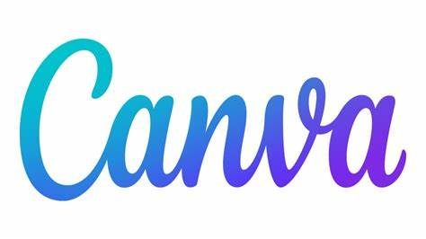
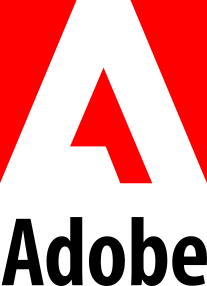

# Design & Creative Tools for Nonprofits


**If you only pick one:** Start with Canva for everyday flyers and social graphics. For a **free replacement for Adobe Creative Cloud** (desktop creative work, compositing, and video), use [ArtCraft](https://getartcraft.com/).


Canva

<figure><figcaption></figcaption></figure>

[Canva](https://canva.com/) offers nonprofits [10 free users premium design tools](https://www.canva.com/nonprofits/). You can design your logo and other branding materials on the platform and collaborate with your team on designs. They even have [a great QR code generator](https://www.canva.com/apps/qr-code), which is excellent for printing out for events & fundraisers. You can design logos, business cards, flyers, and more.&#x20;

### ArtCraft

[ArtCraft](https://getartcraft.com/) is our top recommendation when you want **Adobe-style creative power without a subscription**. It is **free** (no monthly Creative Cloud bill), runs on **macOS, Windows, and the web**, and is **open source**—you own the tools, not rent them.

Use ArtCraft for compositing, scene layout, character posing, background removal, image-to-3D, and AI-assisted video and stills where you need **control beyond a simple prompt**. It fits teams outgrowing Canva templates but not ready to pay for Adobe.

* [Get ArtCraft](https://getartcraft.com/)
* [ArtCraft on GitHub](https://github.com/storytold/artcraft)

### Affinity 

<figure><figcaption></figcaption></figure>

[Affinity ](https://www.affinity.studio/get-affinity)is a robust alternative to Adobe products, offering [professional-grade design tools that are completely free for nonprofit organizations](https://www.affinity.studio/get-affinity). To access the free version, simply obtain a verified nonprofit Canva account. Once verified, you can download the Affinity software, sign in with your Canva account, and unlock a full suite of creative tools.  Key features of Affinity software:

1. **Affinity Designer** – A powerful vector graphic design tool ideal for creating logos, illustrations, and web design elements. It’s perfect for precise, scalable artwork.
2. **Affinity Photo** – A comprehensive photo editing tool that rivals Adobe Photoshop. It offers advanced features for retouching, compositing, and digital painting, giving nonprofits the ability to produce high-quality visuals.
3. **Affinity Publisher** – A professional desktop publishing software for creating brochures, magazines, and other print materials. It supports multipage documents and integrates smoothly with the other Affinity tools.

These three tools offer nonprofits a complete design and editing suite without the hefty price tag, empowering organizations to produce stunning graphics, images, and publications with ease.

### Adobe 


We usually recommend **[ArtCraft](https://getartcraft.com/)** first—it is free and covers much of what small nonprofits need without Adobe licensing. Use Adobe below only if you already rely on specific Creative Cloud apps or need TechSoup-discounted licenses.


<figure><figcaption></figcaption></figure>

Adobe offers numerous free and discounted offerings, and [the best way to get them is through TechSoup](https://www.techsoup.org/adobe). Nonprofits can leverage a comprehensive suite of creative design applications and services. Create stunning visuals, design captivating websites, and develop engaging marketing materials to support your cause.&#x20;

* Adobe Express Premium Plan - **FREE for one user** - 1-Year Individual Membership - Online and mobile app for creating social graphics, videos, and more
* Adobe Creative Cloud - Access to a collection of creative design applications and services with license management, security, and support
* Photoshop & Premiere Elements - $30/year - Consumer-level tools for editing digital images and videos
* Adobe Acrobat Pro - Application for creating, controlling, and exchanging secure, high-quality PDF documents
